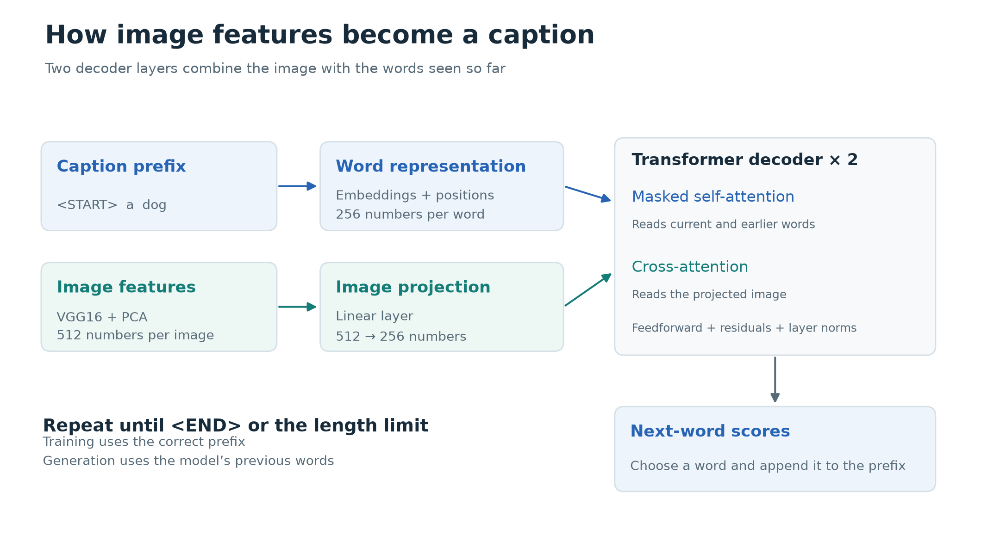
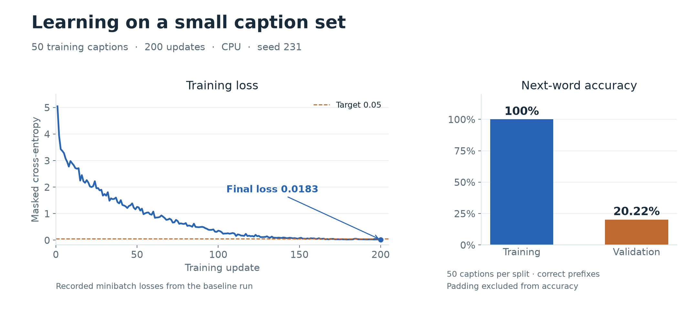

# Image captioning

A PyTorch Transformer that generates captions from precomputed image features.
The implementation favors explicit attention loops and a small training pipeline.

## Architecture

The model takes **512-number image feature vectors** extracted by VGG16 and
reduced with PCA. It generates captions from these features; it does not accept
raw JPEG files directly.

1. **Load the data** — `captioning/data.py` pairs image features with captions
   and converts word IDs back into text.
2. **Build context** — `captioning/layers.py` adds word positions, uses masked
   attention to read earlier words, and cross-attention to incorporate the image.
   Each attention head is processed in a simple loop.
3. **Predict words** — `captioning/model.py` scores possible next words. During
   generation, it repeatedly picks the highest-scoring word until `<END>` or the
   length limit.
4. **Train the model** — `captioning/trainer.py` uses cross-entropy and Adam to
   update weights. For example, `<START> a dog` is trained to predict `a dog <END>`.
   Padding contributes zero loss, but all positions count in the average.

`captioning/train.py` runs training and evaluation; `captioning/predict.py`
loads saved weights to generate a caption.

## Results

The baseline used **50 training captions**, 100 epochs, batch size 25, learning
rate 0.001, and seed 231. It ran on CPU with Python 3.12, PyTorch 2.15.0, and
NumPy 2.5.4.

| Measurement | Result |
| --- | ---: |
| First training minibatch loss | 5.0445 |
| Final training minibatch loss | **0.0183** |
| Training-loss target | Below 0.05 |
| Evaluation loss on training captions | 0.0066 |
| Training next-word accuracy | 100% |
| Evaluation loss on 50 validation captions | 4.4966 |
| Validation next-word accuracy | 20.22% |
| Automated tests | 12 passed |

The model memorizes this small training sample, but captions for unseen images
are still poor. This verifies that training works; it does not establish strong
general captioning performance. Accuracy uses the correct preceding words and
excludes padding. `<UNK>` represents a word outside the supplied vocabulary.

Tests cover attention outputs and gradients, masking, padding, generation, and
data matching. The decoder check allows a small float32 rounding difference
(absolute error below `5e-7`).

Trained weights are in `runs/coco/model.pt`, and the latest metrics are in
`runs/coco/metrics.json`. The recorded baseline is in
[reports/coco_run.json](reports/coco_run.json). CPU is verified; GPU execution
has not been checked.

See [NOTICE.md](NOTICE.md) for source attribution.
